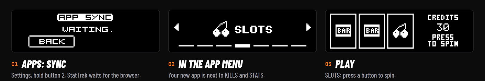

<p align="center">
  
</p>

<p align="center">
  <b>The open firmware of the <a href="https://tridos.design/products/stattrak-hit-counter">StatTrak kill counter</a> by TRIDOS.DESIGN x JZ.</b><br>
  Make your own apps, games and functions for it with an AI coding tool.<br>
  <b>You do not have to be a programmer.</b>
</p>

## 🚀 Start here: paste this into your AI coding tool

Open an AI coding tool in an empty folder on your computer, and paste this text:

```text
I have a StatTrak kill counter. I want to make something new for it: an app, a game or a
new function. Help me, step by step.

1. Download the StatTrak project to this computer:
   git clone https://github.com/trakaismikus/stattrak.git
2. Open the folder "stattrak" and read the file AGENTS.md completely. Follow it.
3. Make a first version of my idea and show me a picture of the screen.
4. Ask me before you install anything on my computer. Tell me what it is and how large it is.

My idea: a dice. I press the right button, and it shows a number from 1 to 6.

I may not be a programmer. Use plain words.
```

**The dice is an example.** Write your own idea in its place, in your own words. No idea yet?
Write "I have no idea yet", and the AI tool helps you to find one.

**What you need:** a computer (Windows, macOS or Linux) and an AI coding tool that can work on
your computer, for example Claude Code, Codex, Cursor, GitHub Copilot (agent mode) or Gemini
CLI. A chat website alone is not enough. You do **not** need your StatTrak to start:
everything runs in a simulator first.

## What happens next

1. **You see a first picture of your idea** after some minutes: the AI tool makes a first
   version and shows you the screen. It asks before it installs anything.
2. **It asks two short questions**, so it knows how to talk with you.
3. **You say what you want different**, or a new idea. For example: *"A timer for the respawn
   wait"*, *"Count my headshots"*, *"A small game for the break"*, *"Make the numbers larger"*.
4. **The AI tool tells you how it builds it:** as an app or as a firmware change (see below).
   You do not have to know the difference.
5. **You see pictures, and you try it in the simulator** on your computer. Not happy with the
   look? Draw the screen yourself in the [Screen Designer](https://stattrak.tridos.design/designer/index.html),
   or ask for new proposals.
6. **You put it on your StatTrak** over Bluetooth, from your browser.
7. **You share it**, if you want: an app in the [app store](https://stattrak.tridos.design/#store),
   a firmware feature as a proposal to us. See [CONTRIBUTING.md](CONTRIBUTING.md).

The device has two buttons, a display of 128 × 32 pixels, a buzzer and Bluetooth. It has no
clock and no internet. The AI tool tells you when an idea cannot work, and why.

## An app or a firmware change?

Your AI tool decides this for you, and tells you. Most ideas are an app.

| | 🧩 An app | 🔧 A firmware change |
| --- | --- | --- |
| **What it is** | A new screen that you add: a game, a timer, a counter | A change of the main software of the StatTrak |
| **Good for** | Almost every new idea | Things that an app cannot do: change a built-in screen, the settings, Bluetooth |
| **It goes on in** | Some seconds | Some minutes, with a restart |
| **The risk** | None for the device. An app runs in a closed box | A faulty firmware can make a device unusable. See the warning below |
| **Share it** | In the app store. Each owner installs it with one click | As a proposal on GitHub. We test it, then it is in the official firmware |

> [!WARNING]
> **You change the firmware at your own risk.** A faulty firmware can make a device unusable
> ("bricked"). This project has many protections against that, and the simulator lets you try
> each change on your computer first. But no test can promise that a changed firmware is safe.
> [docs/SAFETY.md](docs/SAFETY.md) explains the risk. An app does not have this risk.

## The tools

All of them are on one web page: **<https://stattrak.tridos.design>**. Nothing to install.

| Tool | What it does |
| --- | --- |
| 📡 **Firmware** (Web Updater) | Puts a firmware on your StatTrak over Bluetooth: an official release, or your own file. |
| 🧩 **My device** (App Sync) | Installs, sorts and deletes apps. Backup, boot image, app data. |
| 🛒 **App store** | Apps that other owners made. Share your own. |
| ✏️ **Screen Designer** | Draw screens on the real 128 × 32 pixels, then send them to your AI tool. |
| 🖥️ **Simulator** | The real firmware on your computer. You see each change before it goes on the device. |

> [!NOTE]
> Firmware and My device need Bluetooth in the browser: **Chrome, Edge or Opera**, on a
> computer or an Android phone. They do **not** work in Firefox, in Safari or on an iPhone.

<p align="center">
  
</p>

**How to use each tool, step by step, with pictures: [docs/GUIDE.md](docs/GUIDE.md)**
(the buttons of the device, the firmware update, apps, backup, the Screen Designer).

No StatTrak yet? [Get one in the TRIDOS shop](https://tridos.design/products/stattrak-hit-counter).

## 🤝 Share what you made

| You made | Where it goes |
| --- | --- |
| An app | The [app store](https://stattrak.tridos.design/#store). A review checks it within 24 hours. |
| A firmware feature or a fix | A proposal on GitHub ("pull request"). If it is good and safe, it becomes part of the official firmware, with your name on it. |
| Only an idea, or you found a fault | The "Issues" page of this repository. No code is necessary. |

[CONTRIBUTING.md](CONTRIBUTING.md) explains all three in plain words. You do not have to know
GitHub: your AI tool does the technical steps.

## 🛠 For developers

<details>
<summary><b>Commands, hardware and folders</b> (click to open)</summary>

<br>

Everything is one command. The commands work on Windows, macOS and Linux.

```sh
python tools/setup.py              # look: what does this computer have? (changes nothing)
python tools/setup.py simulator    # install cmake, ninja and a C compiler into .venv (550 MB)
python tools/check.py              # safety check, build, unit tests, simulator tests
python tools/sim.py --tour         # a picture of each main view in out/
python tools/sim.py boot click1 click1 frame   # 2 kills, print the display as text
python tools/design.py render designs/example.json   # pictures of a screen design
python tools/app.py new "DICE"                       # start an app: apps/dice/dice.sts, a small counter that works
python tools/app.py build apps/slots/slots.sts       # an app: script -> .stapp package
python tools/app.py run apps/slots/slots.sts press1 wait:2000 png:out/slots.png   # try an app, Python only
python tools/app.py sim apps/slots/slots.sts         # open the web simulator with the app (no install)
python tools/app.py store-check apps/slots/slots.sts # the checks of the app store, before an upload
python tools/setup.py firmware     # install ESP-IDF v5.4 (4 GB). Not necessary with Docker.
python tools/build.py              # tests + firmware build -> build/stattrak.bin
```

- Chip: ESP32-C2, 4 MB flash. Display: 128 x 32 OLED. SDK: ESP-IDF v5.4. Language: C.
- The simulator compiles the real firmware sources for the computer. There is a version
  without a window (for tests and AI tools), one with a window (SDL2) and one for the web
  browser: [sim/README.md](sim/README.md).
- With a serial (UART) connection to the board, `idf.py flash` and `idf.py monitor` work as in
  each ESP-IDF project. Users do not have this connection.

```
main/          application: start sequence, views, settings, storage, battery, Bluetooth commands
components/    graphics, animation, display driver, Bluetooth, firmware update, app engine
designs/       screen design files
apps/          the official apps (StatTrak Script, docs/APPS.md)
skills/        the guides for AI tools: make an app, design a screen, change the firmware
sim/           simulator: the firmware on a computer (headless, window, web)
tests/         tests: full firmware in the simulator, and unit tests
tools/         setup.py, check.py, check_safety.py, sim.py, design.py, app.py, build.py
updater/       the web site: Get started, Firmware, My device, the Screen Designer
docs/          the documents below, and images/
```

</details>

## 📚 Documents

| Document | What is in it |
| --- | --- |
| [docs/GUIDE.md](docs/GUIDE.md) | **User guide:** the buttons, the firmware update, apps, the Screen Designer |
| [CHANGELOG.md](CHANGELOG.md) | **What is new** in each firmware version |
| [AGENTS.md](AGENTS.md) | The rules for AI coding tools (and for you): the start, the safety rules, an app or a firmware change |
| [skills/](skills/) | The guides for AI coding tools: [make an app](skills/stattrak-app/SKILL.md), [design a screen](skills/stattrak-screens/SKILL.md), [change the firmware](skills/stattrak-firmware/SKILL.md) |
| [CONTRIBUTING.md](CONTRIBUTING.md) | How to share an app, a feature or an idea |
| [docs/SAFETY.md](docs/SAFETY.md) | How a device can get bricked, and how to prevent it |
| [docs/APPS.md](docs/APPS.md) | Apps: the app language, the app engine and App Sync |
| [docs/APP_STORE.md](docs/APP_STORE.md) | The app store: the check list before an upload, and the review |
| [docs/DESIGNS.md](docs/DESIGNS.md) | Screen design files |
| [docs/DATA.md](docs/DATA.md) | Backup, app data, device log, start picture and live preview |
| [docs/BLUETOOTH.md](docs/BLUETOOTH.md) | Bluetooth for your own features |
| [sim/README.md](sim/README.md) | The simulator |
| [updater/README.md](updater/README.md) | The web site |
| [docs/AUDIT.md](docs/AUDIT.md) | Code audit, November 2026 |
| [docs/ROADMAP.md](docs/ROADMAP.md) | Planned work |

## Who made it

The firmware is by Janis Zaharans. The [StatTrak kill counter](https://tridos.design/products/stattrak-hit-counter)
is a product of TRIDOS.DESIGN x JZ.

## License

The firmware and the tools are free software under the **GNU General Public License,
version 3 or later** (GPL-3.0-or-later): see [LICENSE](LICENSE). In short: you can use,
change and share it. If you give a changed version to other people, you must give them the
source code under the same license.

Not under this license: the names and logos of TRIDOS and StatTrak, and the product
pictures (also the pictures in `docs/images/`). Other people's parts keep their own licenses:
ESP-IDF and its components (Apache-2.0), the fonts of the Screen Designer and of the web
updater in `updater/fonts/` (SIL Open Font License, the texts are
in these folders).
