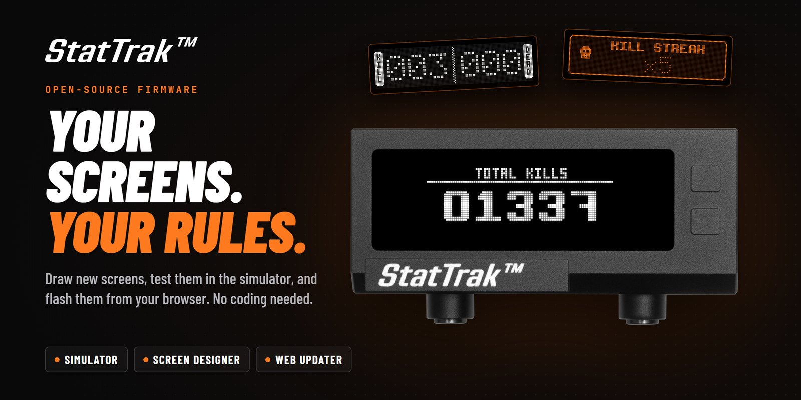
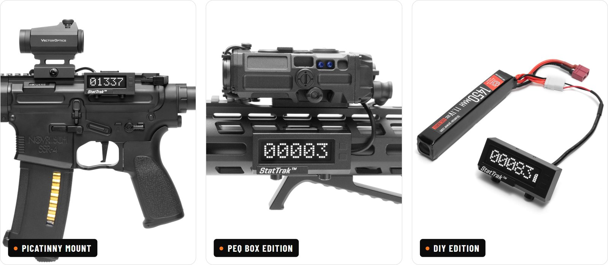
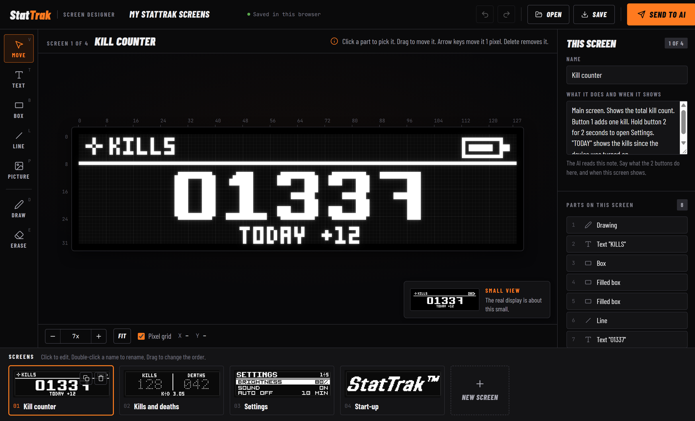
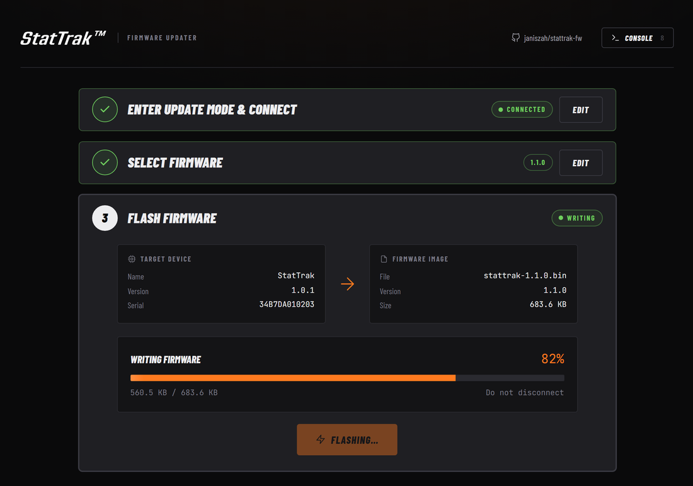
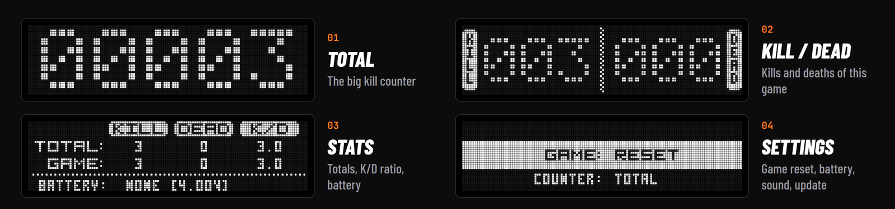

<p align="center">
  
</p>

<p align="center">
  <b>The open firmware of the StatTrak kill counter by TRIDOS.DESIGN x JZ.</b><br>
  Change it, add your own screens, and put your version on your own device.<br>
  <b>You do not have to be a programmer.</b>
</p>

<p align="center">
  <a href="#-start-in-5-minutes">Get started</a> ·
  <a href="#-the-web-updater">Web Updater</a> ·
  <a href="#-the-screen-designer">Screen Designer</a> ·
  <a href="#-how-to-use-the-device">Use the device</a> ·
  <a href="docs/SAFETY.md">Safety</a>
</p>

---

## What is this?

StatTrak is a small kill counter for airsoft. It mounts on your replica and counts your kills
and deaths. This repository is the software inside it: the **firmware**.

The firmware is open. An **AI coding tool** does the technical work on your computer. You tell
it what you want, it shows you pictures of the result, and you decide.

<p align="center">
  
</p>

You get three tools:

| Tool | What it does |
| --- | --- |
| 🖥️ **Simulator** | Runs the real firmware on your computer. You see each change before it goes on the device. |
| ✏️ **Screen Designer** | Draw your own screens on the real 128 × 32 pixels, then send them to your AI tool. |
| 📡 **Web Updater** | Puts a firmware file on your StatTrak over Bluetooth, from your browser. Nothing to install. |

> [!WARNING]
> **You change the firmware at your own risk.** A faulty firmware can make a device unusable
> ("bricked"). This project has many protections against that, and the simulator lets you try
> each change on your computer first. But no test can promise that a changed firmware is safe.
> [docs/SAFETY.md](docs/SAFETY.md) explains the risk.

---

## 🚀 Start in 5 minutes

No coding. Your StatTrak is **not** necessary to start: you can do everything in the simulator.

### What you need

- ✅ A computer with Windows, macOS or Linux.
- ✅ An AI coding tool **that can work on your computer**: for example Claude Code, Codex,
  Cursor, GitHub Copilot (agent mode) or Gemini CLI. A chat website alone is not enough: the
  tool must be able to read files and run programs.
- ✅ [Python](https://www.python.org/downloads/) and [Git](https://git-scm.com/downloads).
  If you do not have them, the AI tool tells you how to get them.

### What you do

**1. Open your AI coding tool in an empty folder and paste this text:**

```text
I have a StatTrak kill counter and I want to change its firmware. Help me, step by step.

1. Download the firmware project to this computer:
   git clone https://github.com/trakaismikus/stattrak.git
2. Open the folder "stattrak" and read the file AGENTS.md completely. Follow it.
   Start with section 1 "Start here".
3. Ask me before you install anything on my computer. Tell me what it is and how large it is.

I may not be a programmer. Use plain words.
```

<!-- TODO (TRIDOS): replace the address above with the final public address of this repository. -->

**2. Answer its questions.** The AI tool then:

1. asks you up to three short questions, so it knows how to talk with you,
2. checks your computer and asks before it installs anything,
3. shows you the real StatTrak screens, running on your computer.

**3. Say what you want.** Some ideas:

- *"Show the kills and the deaths on one screen, with a line between them."*
- *"Add a screen that shows a skull for two seconds after each tenth kill."*
- *"Make the numbers larger."*
- *"Add a second counter for headshots."*

The device has two buttons, a small display, a buzzer and Bluetooth. It has no clock and no
internet. The AI tool tells you when an idea cannot work, and why.

**4. Pick a design.** For a new screen, the AI tool first draws two or three different designs
and shows you the pictures. You pick one. Then it builds the feature and shows it in the
simulator. Only when you are happy, it makes the firmware file for your device.

**5. Put it on your StatTrak** with the [Web Updater](#-the-web-updater).

---

## ✏️ The Screen Designer

You know exactly how a screen must look? **Draw it.** The Screen Designer is a page that opens
in your browser: the file `tools/designer/index.html` in the project folder (double click).
Ask your AI tool to open it for you.

<p align="center">
  
</p>

- **Real pixels, real fonts.** You draw on the 128 × 32 pixels of the device, with its fonts.
  The small view shows how large the screen really is.
- **As many screens as you want.** Write for each screen what it does: when it shows, and what
  the two buttons do. A drawing cannot show that, and the AI tool needs it.
- **Your work is safe.** Undo with Ctrl+Z. The page keeps your work in the browser, and
  **Save** gives you a file.

### Send it to your AI tool

When your screens are ready, click **Send to AI**. Say in one line what you want, then copy the
text and paste it into your AI coding tool. The text has every pixel of your design, so the AI
tool builds exactly what you drew.

<p align="center">
  
</p>

The AI tool can also put its own proposals into the designer, so you can change them there.
For the file format, see [docs/DESIGNS.md](docs/DESIGNS.md).

---

## 📡 The Web Updater

The Web Updater puts a firmware file on your StatTrak over Bluetooth. It is a web page:
**<https://stattrak.tridos.design>**. You do not install anything.

> [!NOTE]
> It works in **Chrome, Edge or Opera**, on a computer or on an Android phone.
> It does **not** work in Firefox, in Safari or on an iPhone.

<table>
  <tr>
    <td width="50%"></td>
    <td width="50%"></td>
  </tr>
  <tr>
    <td><b>1. Connect.</b> On the StatTrak: Settings, then <code>Firmware: UPDATE</code>, hold the right button. The display shows <code>FIRMWARE UPDATE</code> and <code>Waiting...</code>. On the page: <b>Pair device</b>, then pick <code>StatTrak</code>.</td>
    <td><b>2. Select the file.</b> Drop your firmware file on the page (the AI tool makes it: <code>out/stattrak-...bin</code>), or pick an official release. The page refuses a file that is not a StatTrak firmware.</td>
  </tr>
  <tr>
    <td></td>
    <td></td>
  </tr>
  <tr>
    <td><b>3. Flash.</b> Click <b>Flash firmware</b> and confirm. Keep the device near the computer and the page open.</td>
    <td><b>4. Done.</b> The StatTrak restarts and shows <code>Verifying...</code>. If the display stays off, switch the device on. The page connects again and confirms the firmware. The display shows <code>Complete</code>. Press a button.</td>
  </tr>
</table>

### If something goes wrong

| What you see | What to do |
| --- | --- |
| `Error`, or the transfer stops | Nothing is lost. The old firmware is still there. Start again. |
| `Verifying...` does not go away | Switch the device off (hold both buttons). It starts with the old firmware again. |
| The device does not work as before | Hold both buttons for **10 seconds** while you switch it on. The update mode opens. Install the official firmware. |

The old firmware stays in the device until the Web Updater confirms the new one. After that
moment the device cannot go back by itself. That is why the tests and the simulator come first.

More about the page: [updater/README.md](updater/README.md).

---

## 🎮 How to use the device

<p align="center">
  
</p>

| Action | Result |
| --- | --- |
| Hold both buttons | Power on / power off |
| Short press on both buttons | Next view: total, kill/death, statistics, settings |
| Total view: short press | +1 kill. Long press: -1 kill |
| Kill/death view: button 1 / button 2 | +1 kill / +1 death. Long press: -1 |
| Settings: short press button 1 / 2 | Up / down |
| Settings: long press button 1 / 2 | Previous / next value, or start the action |
| Hold both buttons for 10 seconds at power-on | Firmware update mode |

---

## 🤝 Share what you made

Did you make something that other StatTrak owners will like? You can send it to us. If it is
good and safe, it becomes part of the official firmware, with your name on it.
[CONTRIBUTING.md](CONTRIBUTING.md) explains how, in plain words. You do not have to know
GitHub: your AI tool does the technical steps.

Only an idea, no code? Tell us on the "Issues" page of this repository ("Feature idea").

---

## 🛠️ For developers

<details>
<summary><b>Commands, hardware and folders</b> (click to open)</summary>

<br>

Everything is one command. The commands work on Windows, macOS and Linux.

```sh
python tools/setup.py              # look: what does this computer have? (changes nothing)
python tools/setup.py simulator    # install cmake, ninja and a C compiler into .venv (550 MB)
python tools/check.py              # safety check, build, unit tests, simulator tests
python tools/sim.py --tour         # a picture of each main view in out/
python tools/sim.py boot click1 click1 frame   # 2 kills, print the display as text
python tools/design.py render designs/example.json   # pictures of a screen design
python tools/setup.py firmware     # install ESP-IDF v5.4 (4 GB). Not necessary with Docker.
python tools/build.py              # tests + firmware build -> build/stattrak.bin
```

- Chip: ESP32-C2, 4 MB flash. Display: 128 x 32 OLED. SDK: ESP-IDF v5.4. Language: C.
- The simulator compiles the real firmware sources for the computer. There is a version
  without a window (for tests and AI tools), one with a window (SDL2) and one for the web
  browser: [sim/README.md](sim/README.md).
- With a serial (UART) connection to the board, `idf.py flash` and `idf.py monitor` work as in
  each ESP-IDF project. Users do not have this connection.

```
main/          application: start sequence, views, settings, storage, battery, Bluetooth commands
components/    graphics, animation, display driver, Bluetooth, firmware update
designs/       screen design files
sim/           simulator: the firmware on a computer (headless, window, web)
tests/         tests: full firmware in the simulator, and unit tests
tools/         setup.py, check.py, check_safety.py, sim.py, design.py, build.py
updater/       the web updater: the page that sends a firmware file to the device
docs/          SAFETY.md, BLUETOOTH.md, DESIGNS.md, AUDIT.md, ROADMAP.md, images/
```

</details>

---

## 📚 Documents

| Document | What is in it |
| --- | --- |
| [AGENTS.md](AGENTS.md) | Rules and work sequence for AI coding tools (and for you) |
| [CONTRIBUTING.md](CONTRIBUTING.md) | How to share a feature or an idea |
| [docs/SAFETY.md](docs/SAFETY.md) | How a device can get bricked, and how to prevent it |
| [docs/DESIGNS.md](docs/DESIGNS.md) | Screen design files |
| [docs/BLUETOOTH.md](docs/BLUETOOTH.md) | Bluetooth for your own features |
| [sim/README.md](sim/README.md) | The simulator |
| [updater/README.md](updater/README.md) | The Web Updater |
| [docs/AUDIT.md](docs/AUDIT.md) | Code audit, November 2026 |
| [docs/ROADMAP.md](docs/ROADMAP.md) | Planned work |

## Who made it

The firmware is by Janis Zaharans. The StatTrak kill counter is a product of TRIDOS.DESIGN x JZ.

## License

The firmware and the tools are free software under the **GNU General Public License,
version 3 or later** (GPL-3.0-or-later): see [LICENSE](LICENSE). In short: you can use,
change and share it. If you give a changed version to other people, you must give them the
source code under the same license.

Not under this license: the names and logos of TRIDOS and StatTrak, and the product
pictures (also the pictures in `docs/images/`). Other people's parts keep their own licenses:
ESP-IDF and its components (Apache-2.0), the fonts of the Screen Designer and of the web
updater in `tools/designer/fonts/` and `updater/fonts/` (SIL Open Font License, the texts are
in these folders).
