# StatTrak user guide

How to use your StatTrak and the web page <https://stattrak.tridos.design>: the buttons, the
firmware update, the apps and the Screen Designer. The short start is in the
[README](../README.md).

1. [How to use the device](#1-how-to-use-the-device)
2. [Update the firmware: the Web Updater](#2-update-the-firmware-the-web-updater)
3. [Apps and App Sync](#3-apps-and-app-sync)
4. [The Screen Designer](#4-the-screen-designer)

## 1. How to use the device

  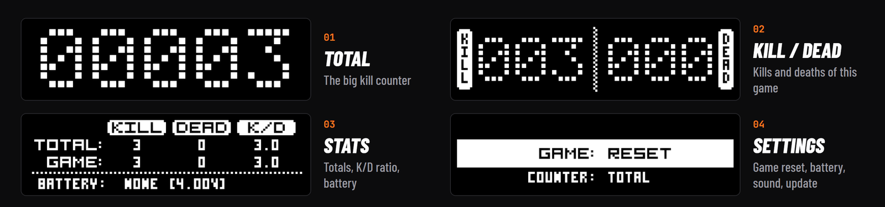

| Action | Result |
| --- | --- |
| Hold both buttons | Power on / power off |
| Short press on both buttons | App menu: KILLS, KILLS + DEAD, STATS, your installed apps, SETTINGS |
| App menu: left button / right button | Previous / next app |
| App menu: both buttons, or wait 3 seconds | Open the selected app |
| App menu: hold the right button | The settings of the selected installed app (if it has settings) |
| Settings: `Apps: SYNC`, hold the right button | App Sync: install and sort apps from your browser (see [Apps and App Sync](#3-apps-and-app-sync)) |
| App: a fast game (RUNNER) | It reacts when the button goes down. Other apps get a press after the release |
| Total view: short press | +1 kill. Long press: -1 kill |
| Kill/death view: left button / right button | +1 kill / +1 death. Long press: -1 |
| Settings: short press left / right button | Up / down |
| Settings: long press left / right button | Previous / next value, or start the action |
| A button on the display (YES, NO, BACK, OK, CANCEL, DISMISS, SYNC MORE, OPEN) | Hold the round button under it for 0.7 s; the button fills while you hold it. A short press does nothing. A button in the middle: either round button |
| Hold both buttons for 10 seconds at power-on | Firmware update mode |

## 2. Update the firmware: the Web Updater

The Web Updater puts a firmware file on your StatTrak over Bluetooth. It is a web page:
**<https://stattrak.tridos.design>**. You do not install anything.

> [!NOTE]
> It works in **Chrome, Edge or Opera**, on a computer or on an Android phone.
> It does **not** work in Firefox, in Safari or on an iPhone.

<table>
  <tr>
    <td width="50%">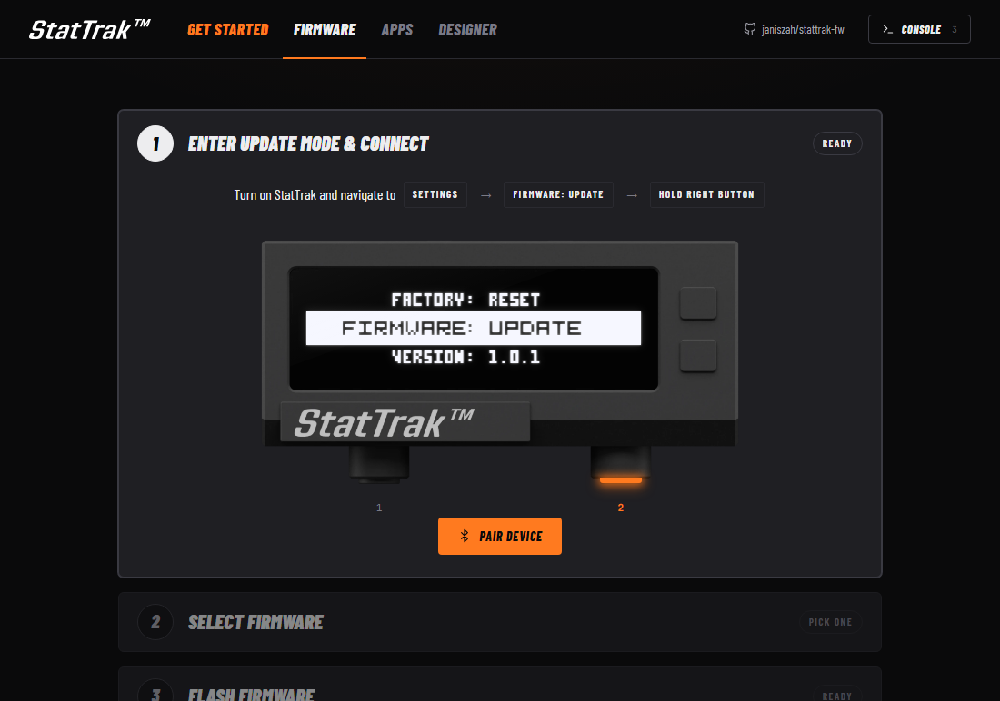</td>
    <td width="50%">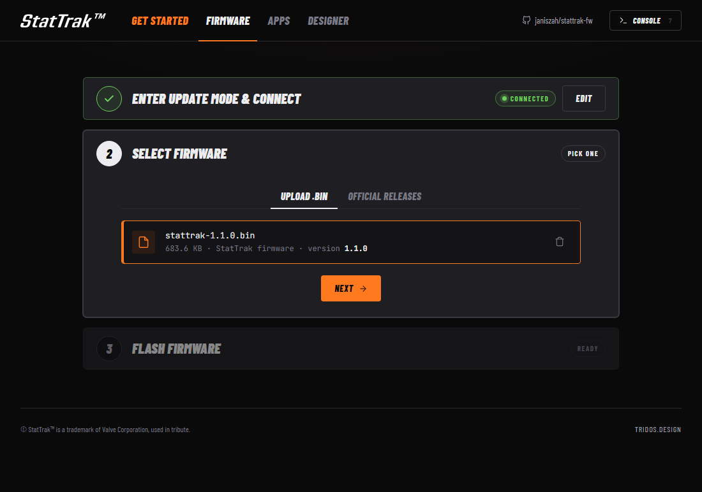</td>
  </tr>
  <tr>
    <td><b>1. Connect.</b> On the StatTrak: Settings, then <code>Firmware: UPDATE</code>, hold the right button. The display shows <code>FIRMWARE UPDATE</code> and <code>Waiting...</code>. On the page: <b>Pair device</b>, then pick <code>StatTrak</code>.</td>
    <td><b>2. Select the file.</b> For an official firmware: <b>Use this</b> next to a release on the <b>Official releases</b> tab (no download needed). For your own firmware: drop the file on <b>Upload .bin</b> (the AI tool makes it: <code>out/stattrak-...bin</code>). The page refuses a file that is not a StatTrak firmware. Click <b>Next</b>.</td>
  </tr>
  <tr>
    <td>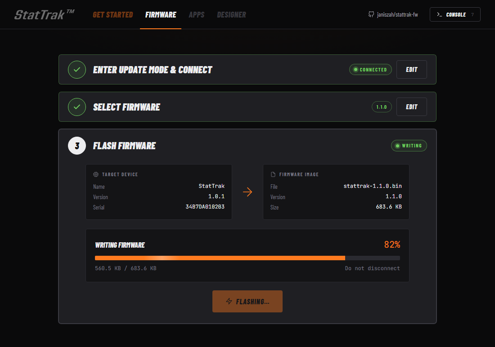</td>
    <td>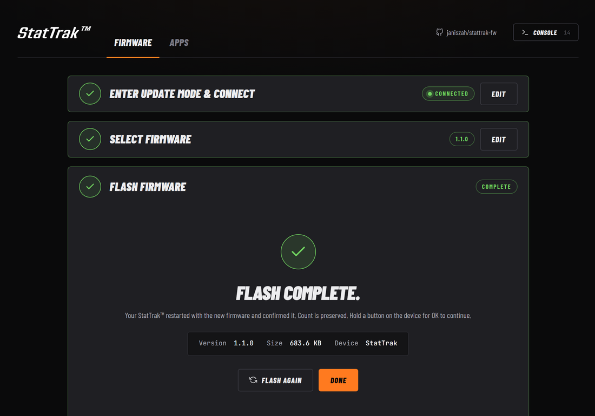</td>
  </tr>
  <tr>
    <td><b>3. Flash.</b> Click <b>Flash firmware</b> and confirm. Keep the device near the computer and the page open.</td>
    <td><b>4. Done.</b> The StatTrak restarts and shows <code>Verifying...</code>. If the display stays off, switch the device on. The page connects again and confirms the firmware. The display shows <code>Complete</code>. Hold a button for OK.</td>
  </tr>
</table>

### If something goes wrong

| What you see | What to do |
| --- | --- |
| `Error`, or the transfer stops | Nothing is lost. The old firmware is still there. Start again. |
| `Verifying...` does not go away | Switch the device off (hold both buttons). It starts with the old firmware again. |
| The device does not work as before | Hold both buttons for **10 seconds** while you switch it on. The update mode opens. Install the official firmware. |

The old firmware stays in the device until the Web Updater confirms the new one. After that
moment the device cannot go back by itself. That is why the tests and the simulator come first.

More about the page: [updater/README.md](../updater/README.md).

## 3. Apps and App Sync

Your StatTrak can run **apps**, like a watch. An app is a small file (up to 4 KB): a game, a
timer, a different counter. You install it over Bluetooth from your browser, in the **My device**
tab of the Web Updater. The firmware stays the same, so an app install takes a few seconds. The
firmware checks each app, and an app runs in a closed box: it cannot touch the firmware update,
Bluetooth or the power.

  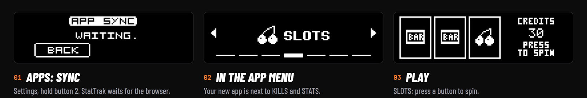

> [!NOTE]
> Apps need a firmware with the app menu. If the page says **Update the firmware first**,
> install the newest firmware with the [Web Updater](#2-update-the-firmware-the-web-updater) first.

### Install an app

1. **On the StatTrak:** Settings, then `Apps: SYNC`, hold the right button. The display shows
   `APP SYNC` and `WAITING`.
2. **On the computer:** open <https://stattrak.tridos.design/#device> (the **My device** tab), click
   **Connect** and pick your StatTrak.
3. Click **Install** next to an app.
4. **Answer on the StatTrak.** It asks `INSTALL <NAME>?`. Hold the right button for yes, or the left button for
   no. The page sends the app only after your yes.

<table>
  <tr>
    <td width="50%">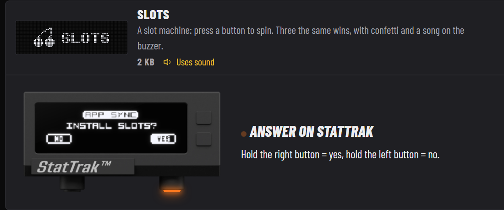</td>
    <td width="50%">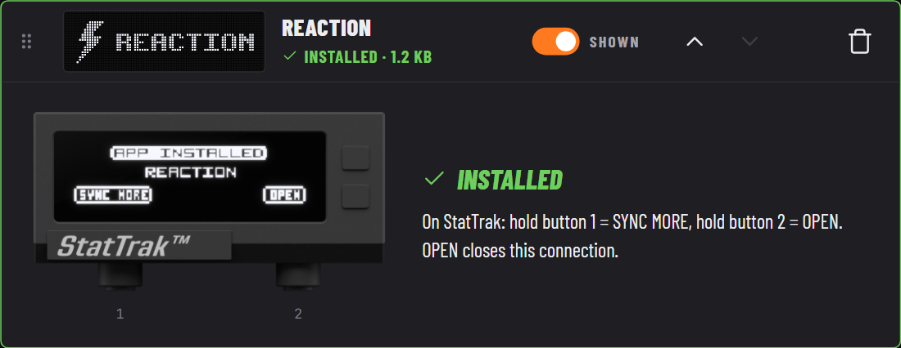</td>
  </tr>
  <tr>
    <td><b>The question.</b> The page shows what your StatTrak shows. The button to hold is orange.</td>
    <td><b>Installed.</b> On the StatTrak: hold the left button for <b>SYNC MORE</b> (install one more app), or hold the right button for <b>OPEN</b> (play now).</td>
  </tr>
</table>

### Sort, hide and delete

The My device tab shows all apps on your StatTrak, in the order of the app menu. You can:

- move an app up or down (drag it, or use the arrows),
- hide an app from the menu, or show it again,
- change the settings of an app where you see a gear. On the StatTrak: in the app menu, hold
  the right button on the app,
- delete an app (the bin). The built-in apps stay.
- give your StatTrak its own Bluetooth name, so you find it fast when there are more StatTraks
  (for example `StatTrak | RED 7`). It changes the next time you open `Apps: SYNC`.

The bar at the top shows how much of the 24 KB for apps you use. `SETTINGS` is always the last
app in the menu, so you can always get to the firmware update.

  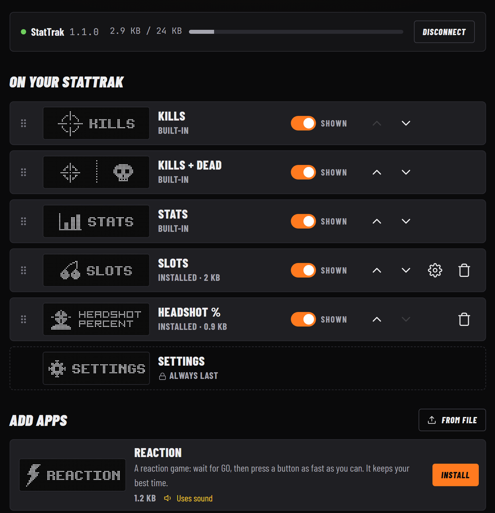

### The apps you can install now

These are the official apps. The **App store** tab of the web page
(<https://stattrak.tridos.design/#store>) also has the apps that other owners made.

| App | What it does |
| --- | --- |
| **BATTERY LOG** | Logs the battery voltage each 1, 2 or 5 minutes until the battery is empty. Download the log on the My device tab. |
| **CLIP MARKS** | For video: press 2 when the camera starts, 1 for each kill. Each kill gets a time mark that you download for your video editor. |
| **HEADSHOT %** | Counts kills and headshots and shows the headshot percentage. |
| **REACTION** | A reaction game: wait for GO, then press a button as fast as you can. |
| **RESPAWN TIMER** | The wait at the respawn point in big digits. Flashes and chimes when you can go. As the background app it comes back on the screen when the time is up (firmware 1.2.0-b3). |
| **ROUND TIMER** | Times each round, and beeps at the end. |
| **RUNNER** | An endless runner: jump over the cacti. The game gets faster. |
| **SLOTS** | A slot machine. Three the same wins, with confetti and a song on the buzzer. |
| **WALLPAPER** | Looks like the big KILLS counter, but shows your own number. |

### Boot image, backup, app data, device log

These parts of My device need firmware 1.2.0-b2 or newer. They are above your app list; click a
part to open it.

- **Backup.** *Download backup* saves your stats, your settings, the app menu, the settings and
  saved values of each app, the Bluetooth name and the boot image in one file. *Restore from
  file* puts them back, on this StatTrak or on a new one. You pick the parts (for example only
  the settings, to copy them to a friend's StatTrak). The StatTrak asks "RESTORE BACKUP?" first.
  The app files are not in the backup: install the apps first, the page tells you which.
- **App data.** Apps like BATTERY LOG and CLIP MARKS keep rows of numbers on the StatTrak
  (4 KB for each app). *Download CSV* gives you a file for a spreadsheet or a video editor.
  *Delete data* asks on the StatTrak first.
- **Boot image.** Choose a PNG or JPG: the StatTrak shows it for 2 seconds when you switch it
  on, then your first app slides in. Make one in the Screen Designer and use *Download PNG*
  there. Without a boot image, the StatTrak starts with your first app at once.
- **Device log.** Why the StatTrak started the last 64 times (switched on, restart, brown-out,
  crash) and the battery level. It helps when you report a fault.

In the Screen Designer, **Show on StatTrak** puts the screen that you draw on your StatTrak.
Connect your StatTrak first (the StatTrak button at the top right, the device in `Apps: SYNC`).
The screen stays on the StatTrak until you press a button on it or send the next one. Your
StatTrak stays connected when you go from My device to the Designer and back.

### Make your own app

Your AI coding tool makes it for you: the text to start is at the top of the
[README](../README.md). You can try the app on your computer first, and you can share it in
the app store ([CONTRIBUTING.md](../CONTRIBUTING.md)).

The details for AI tools and developers: [APPS.md](APPS.md).

## 4. The Screen Designer

You know exactly how a screen must look? **Draw it.** The Screen Designer is a page that opens
in your browser: **<https://stattrak.tridos.design/designer/index.html>**, or the file
`updater/designer/index.html` in the project folder (double click, it works without the internet).
Ask your AI tool to open it for you.

  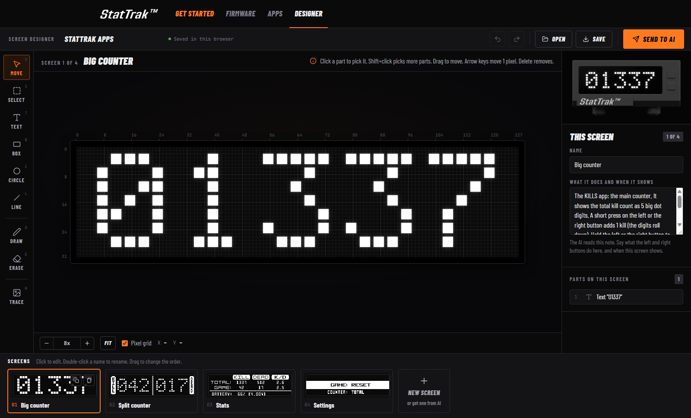

- **Real pixels, real fonts.** You draw on the 128 × 32 pixels of the device, with its fonts.
  The device picture at the top shows the screen as it looks on the StatTrak.
- **Starts with the real screens.** The designer opens with the 4 built-in screens (Big counter,
  Split counter, Stats, Settings), pixel for pixel as the firmware draws them. Change one, or
  click **New screen** and ask your AI tool for any other screen: the designer gives you the
  request to copy, and you paste the answer back.
- **Tools for pixel work.** Text, Box (round corners up to round ends), Circle, Line, Draw and
  Erase. **Select** moves more parts, or some pixels of a drawing, as a group, or makes one
  drawing of them: **Combine**, **Intersect** or **Subtract** (cut the front parts out of the
  back part). A **cut-out
  border** keeps a part clear on top of other parts. A black part shows red while it is selected.
  **Trace** puts a picture (a sketch, an emoji) under the screen to draw over; only you see it.
- **As many screens as you want.** Write for each screen what it does: when it shows, and what
  the two buttons do. A drawing cannot show that, and the AI tool needs it.
- **Your work is safe.** Undo with Ctrl+Z. The page keeps your work in the browser, and
  **Save** gives you a file.

### Send it to your AI tool

When your screens are ready, click **Send to AI**. Say in one line what you want, then copy the
text and paste it into your AI coding tool. The text has every pixel of your design, so the AI
tool builds exactly what you drew.

  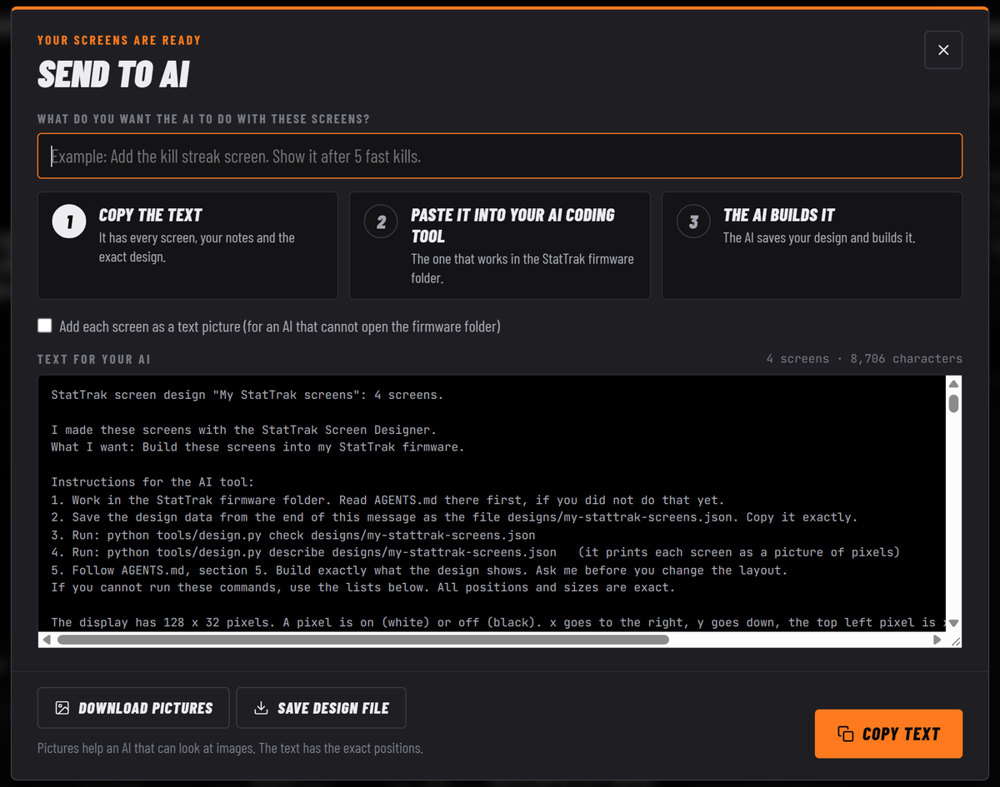

The AI tool can also put its own proposals into the designer, so you can change them there.
For the file format, see [DESIGNS.md](DESIGNS.md).
